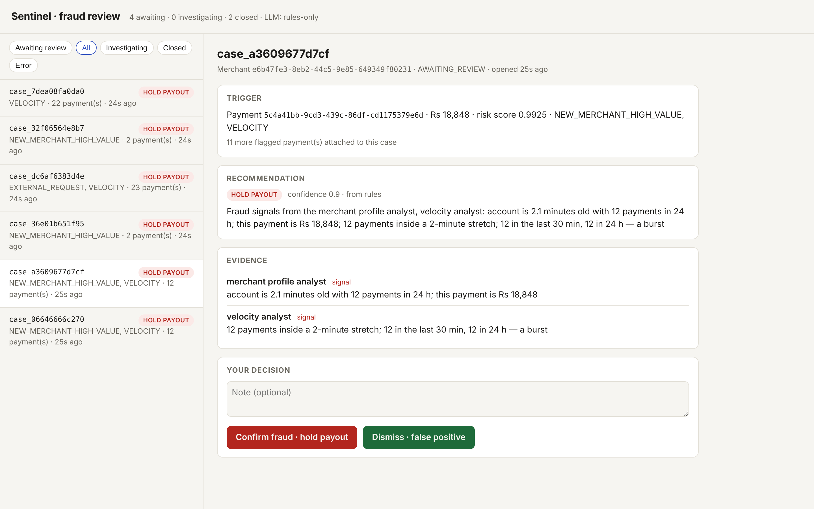
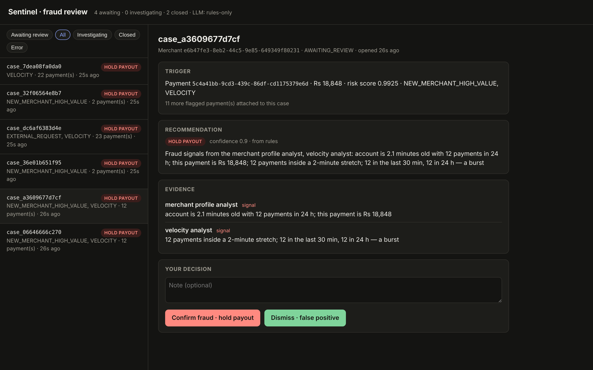
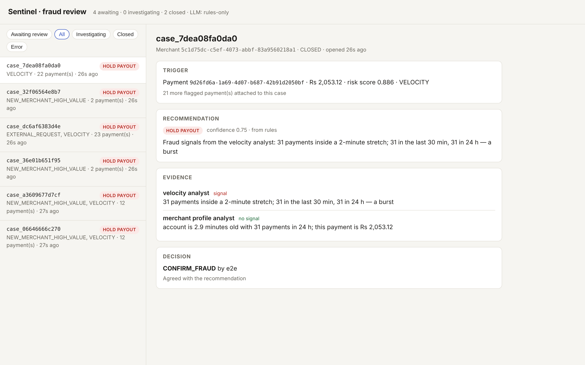
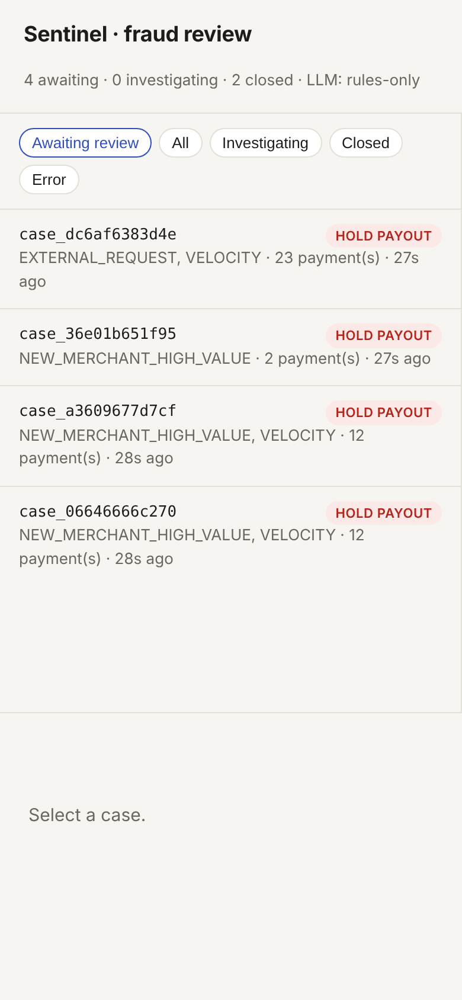

# Transakt Sentinel

[](https://github.com/ARV0007/transakt-sentinel/actions/workflows/ci.yml)

**An agentic fraud-investigation system for the [Transakt](https://github.com/ARV0007/transakt) payment gateway.**
Every settled payment is scored by a fast ML model; risky ones are investigated by a
LangGraph agent that gathers evidence through **MCP** tools and writes a recommendation
with an LLM — then **stops and waits for a human analyst**. Transakt itself is not modified.

`Python 3.12` · `LangGraph` · `LangChain` · `MCP` · `A2A` · `FastAPI` · `Kafka` · `Redis` · `scikit-learn` · `Hugging Face` · `LangSmith` · `Prometheus` · `Grafana` · `Docker`

```
Transakt ──payment.settled──► risk-scorer ──fraud.cases──► investigator ──► analyst
 (Java,      (Kafka, outbox)   (ML, <1 ms,     (Kafka)      (LangGraph +      review page
 unchanged)                     no LLM)                      MCP + LLM,        :8003
                                                             human-in-loop)
                                      transakt-mcp ◄── MCP tools ──┘
```

## What makes it interesting

- **MCP as the integration layer.** The agent reaches Transakt only through six read-only
  MCP tools — the same server works with the MCP Inspector or Claude Desktop, no extra code.
- **LLM only where reasoning is needed.** A gradient-boosted model scores every payment in
  microseconds; the LLM sees only flagged cases (one per incident, not one per payment).
- **Human-in-the-loop that survives restarts.** LangGraph checkpoints every step; a case paused
  for review resumes after the container restarts (there's a test for exactly that).
- **Deliberate failure policies.** Broken tool → "could not check". LLM down → rules.
  No evidence at all → `NEEDS_MANUAL_REVIEW`, never `ALLOW`.
- **Grounding check** on every LLM rationale: numbers not present in the evidence are flagged.
- **Restart-safe scoring.** Merchant history lives in Redis, so a redeploy doesn't hand fraudsters a
  clean slate; a replayed Kafka event is never counted twice.
- **No pickles.** The model is saved with skops and loaded through a type allow-list, so a tampered
  file from the Hub is refused instead of executed.
- **Concurrency-safe state.** History is read and recorded in one Lua script inside Redis. A test with two
  replicas and 200 concurrent payments keeps all 200; a naive read-then-write version kept 2.
- **Agent-to-agent (A2A).** Other AI agents can discover Sentinel at `/.well-known/agent-card.json` and ask it
  to investigate a payment — they get a recommendation, a human still decides.
- **Humans teach the model.** Analyst decisions export as labels; `./sentinel.sh retrain` folds them in. A test
  shows a repeatedly dismissed pattern stops being flagged while real fraud is still caught.
- **Observable.** Prometheus metrics on every service and a provisioned Grafana dashboard: flag rate, scoring
  lag, recommendations, analyst overrides, MCP tool latency.
- **Secured internals.** The MCP server holds admin credentials, so it requires a bearer token
  (constant-time compared); tokens are generated into `.env` and never printed.
- **Measured, not claimed.** A simulator plants labelled fraud; `eval/evaluate.py` reports
  precision/recall, incident detection, false alarms and how much traffic reached the LLM.
- **Event-driven microservices** split by speed, scaling and failure behaviour, at-least-once
  Kafka consumers made idempotent by primary keys.

## Screenshots

An investigation waiting for an analyst: the evidence each specialist gathered through MCP, the
recommendation, and the two buttons only a human can press.



<details><summary>Dark mode, a decided case, and the phone layout</summary>





</details>

A 2-minute walkthrough script is in [docs/DEMO.md](docs/DEMO.md).

## Results

A real run on a MacBook Air: Transakt + Kafka + Postgres + Redis in Docker, 6 minutes of simulated
traffic, 199 payments with 6 planted fraud incidents (`./sentinel.sh demo`, 23 Oct 2026; re-run on
v1.2 with MCP auth, Redis-backed history and monitoring, same outcome — 6/6, 0 false cases):

| Metric | Result |
|---|---|
| Fraud incidents that became a case | **6 / 6** — all recommended `HOLD_PAYOUT` |
| Cases opened on the 20 normal merchants | **0** |
| Payment-level precision / recall | 0.947 / 0.818 |
| Recall by pattern | new-merchant blitz 24/24 · amount spike 4/4 · velocity burst 44/60 |
| Payment → risk score | 2.7 s median, 5.0 s p95 (mostly Transakt's 5 s outbox sweep); the model itself scores in ~1 ms |
| Traffic that reached the LLM step | 3% (one case per incident, not one per payment) |

Velocity recall is the lowest by design: the first few payments of a burst *are* normal-looking,
and the system flags it once the pace is unmistakable (first flag 14–22 s into the burst).
Training data is synthetic, so treat these as a working baseline, not a production claim.

## Run it locally

You need Docker Desktop, Python 3.12 and Transakt cloned next to this repo
(`~/Documents/Coding/transakt` and `~/Documents/Coding/transakt-sentinel`).

```bash
./sentinel.sh up          # Transakt + Postgres + Redis + Kafka + the three Sentinel services
./sentinel.sh bootstrap   # creates the admin account Sentinel reads with (local DB only)
./sentinel.sh simulate    # ~6 minutes of traffic with planted fraud
./sentinel.sh eval        # grades the run -> eval/results/latest.md
```

Then open **http://localhost:8003** to review cases and **http://localhost:3000** for the Grafana
dashboard. `./sentinel.sh demo` runs all four. After deciding a few cases, `./sentinel.sh retrain`
retrains the scorer on your decisions.

**Ask Sentinel from another agent (A2A):**

```bash
TOKEN=$(grep ^A2A_TOKEN .env | cut -d= -f2)
curl -s localhost:8003/a2a -H "Authorization: Bearer $TOKEN" -H "A2A-Version: 1.0" \
  -H "Content-Type: application/json" -d '{"jsonrpc":"2.0","id":1,"method":"SendMessage",
  "params":{"message":{"messageId":"1","role":"ROLE_USER","parts":[{"data":{"payment_id":"<id>"}}]}}}'
```

**Turn the LLM on (optional):** put a Hugging Face token in `.env` as `LLM_API_KEY`, then
`./sentinel.sh up` again. Without one, deterministic rules write the recommendations and
everything else works the same. **Tracing:** set `LANGSMITH_TRACING=true` and `LANGSMITH_API_KEY`.

## Tests

```bash
cd services/<service> && pip install -r requirements-dev.txt && pytest
python e2e/run_e2e.py      # whole pipeline against a fake Transakt (no Java/Kafka needed)
python e2e/run_e2e.py --keep-running   # same, then leaves the review page up on :18003 — a Docker-free demo
```

CI runs all unit suites plus the end-to-end run on every push.

## Repository

| Path | What |
|---|---|
| `services/transakt-mcp` | MCP server: Transakt data as read-only tools |
| `services/risk-scorer` | Kafka consumer, streaming features, ML model, HF Hub loading |
| `services/investigator` | LangGraph agent, FastAPI, review page, checkpoints |
| `simulator/` | Plants labelled fraud into local Transakt traffic |
| `eval/` | Grades a run against the simulator's labels |
| `e2e/` | Fake Transakt + full-pipeline test used by CI |
| `monitoring/` | Prometheus config, Grafana data source and dashboard (provisioned) |
| `docs/` | `architecture.md`, `notes.md`, `WORKLOG.md`, `UNDERSTANDING.md` |

## Honest limitations

Merchant fraud only (Transakt records no card/device data); training data is synthetic; decisions are recorded but not yet enforced in Transakt.
Details in [docs/architecture.md](docs/architecture.md#known-limitations-v1).
