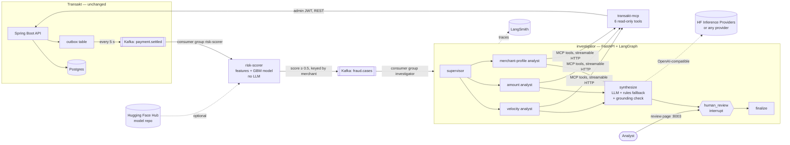

# Transakt Sentinel — architecture

**Version 1.0** · 22 Oct 2026

Sentinel is a fraud-investigation system that sits beside the Transakt payment
gateway. It scores every settled payment, investigates the risky ones with a
LangGraph agent that gathers evidence through MCP tools, and stops for a human
analyst before anything is decided. Transakt itself is not modified.

## System

## Services

| Service | Port | Job | Scales with | Fails how |
|---|---|---|---|---|
| Transakt (existing) | 8080 | Takes payments, publishes `payment.settled` | Payment volume | — |
| `risk-scorer` | 8002 | Scores **every** payment in < 1 ms | Payment volume | If down, events wait in Kafka; payments are unaffected |
| `investigator` | 8003 | Investigates **flagged** payments, waits for a human | Number of cases | If down, cases wait in Kafka; scoring is unaffected |
| `transakt-mcp` | 8001 | The only door from the agent into Transakt | Investigator's tool calls | If down, specialists record "could not check" and the case goes to a human |

The boundaries follow **different speed, different scaling, different failure
behaviour** — not a wish to have many services.

## Key decisions

| Decision | Why | Trade-off |
|---|---|---|
| Consume Transakt's existing outbox topic | Zero changes to Transakt; transactional outbox already guarantees no lost events | Scoring happens *after* settlement, so v1 holds payouts rather than blocking card swipes |
| Admin JWT for cross-merchant reads | Transakt already returns every merchant's payments to an ADMIN | Admin list has no merchant filter, so window scans cost O(total traffic) |
| Scorer → investigator over **Kafka**, not HTTP | An investigator waiting on an LLM can never back-pressure scoring; cases are durable | One more topic to operate |
| Classic ML for scoring, LLM only for synthesis | Every payment must be scored fast and free; reasoning is needed only on the ~5% that are flagged | Two kinds of model to maintain |
| Deterministic supervisor routing | Routing on reason codes is a lookup, not a judgement | Less "agentic" than an LLM router, and more predictable |
| One open case per merchant (30-min window) | A 30-payment burst is one incident, not 30 tickets | A second, unrelated pattern from the same merchant joins the open case |
| SQLite checkpoints, thread id = case id | Pause for a human, survive restarts, resume crashes — all from one mechanism | Single-writer; Postgres checkpointer for multiple replicas |
| No evidence → `NEEDS_MANUAL_REVIEW`, never `ALLOW` | Unknown is not safe. (Contrast: Transakt's rate limiter fails *open* to protect availability.) | More human work during an outage |
| MCP SDK pinned `<2` | v2 renamed FastMCP and broke the LangChain adapter at the time of building | Re-evaluate when the ecosystem settles |
| Model trained at Docker build | No binary in git; image always matches its feature code | Build takes a few seconds longer |

## Data contracts

`payment.settled` (produced by Transakt's outbox):
`{eventId, paymentId, merchantId, status, amountPaise, currency}`

`fraud.cases` (produced by risk-scorer, key = merchantId):
`{payment_id, merchant_id, amount_paise, currency, status, score, reasons[], features{}, model_version, flagged_at}`

Reason codes: `VELOCITY` (≥ 8 payments in 2 min), `AMOUNT_SPIKE` (≥ 10× own median),
`NEW_MERCHANT_HIGH_VALUE` (< 15 prior payments and ≥ Rs 10,000), `MODEL_ONLY`.

## Known limitations (v1)

- Merchant fraud only. Card fraud needs customer/card/device fields Transakt doesn't record.
- Scorer state is in memory; a restart forgets merchant history (Redis is the fix).
- Training data is synthetic, built from the same patterns the simulator plants, so the model's offline metrics are optimistic. Next: mix in PaySim.
- `finalize` records the decision only; Transakt has no hold-payout endpoint yet.
- The joblib model file is a pickle; only load it from a Hub repo you control (skops/ONNX planned).
- Kafka exists only in local Docker Compose, so the full pipeline demo runs locally, not on Render.
