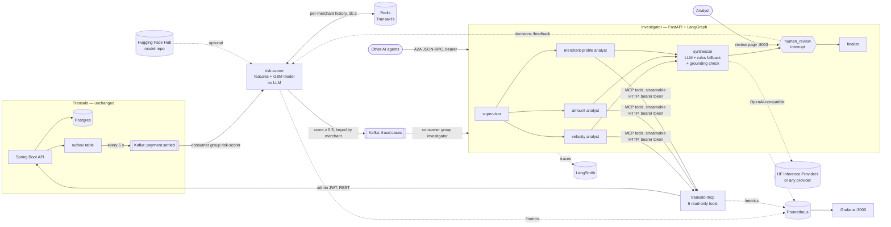

# Transakt Sentinel — architecture

**Version 1.3** · 23 Oct 2026

*1.3: the scorer scores in batches (one model call, one pipelined Redis round trip per Kafka poll) and
re-sends a flagged payment's case on redelivery; retraining is gated on held-out analyst decisions; the eval
report sweeps thresholds.*

*1.2: MCP server requires a bearer token; scorer history updated atomically by a Lua script;
Prometheus metrics on every service plus a provisioned Grafana dashboard; analyst decisions
feed retraining; the investigator is also an A2A agent other agents can call.*
*1.1: scorer history moved to Redis; model file moved from pickle to skops.*

Sentinel is a fraud-investigation system that sits beside the Transakt payment
gateway. It scores every settled payment, investigates the risky ones with a
LangGraph agent that gathers evidence through MCP tools, and stops for a human
analyst before anything is decided. Transakt itself is not modified.

## System

## Services

| Service | Port | Job | Scales with | Fails how |
|---|---|---|---|---|
| Transakt (existing) | 8080 | Takes payments, publishes `payment.settled` | Payment volume | — |
| `risk-scorer` | 8002 | Scores **every** payment in < 1 ms | Payment volume | If down, events wait in Kafka; payments are unaffected |
| `investigator` | 8003 | Investigates **flagged** payments, waits for a human | Number of cases | If down, cases wait in Kafka; scoring is unaffected |
| `transakt-mcp` | 8001 | The only door from the agent into Transakt | Investigator's tool calls | If down, specialists record "could not check" and the case goes to a human |
| Prometheus / Grafana | 9090 / 3000 | Scrape `/metrics` every 5 s; one provisioned dashboard | — | Monitoring only; nothing depends on them |

The boundaries follow **different speed, different scaling, different failure
behaviour** — not a wish to have many services.

## Key decisions

| Decision | Why | Trade-off |
|---|---|---|
| Consume Transakt's existing outbox topic | Zero changes to Transakt; transactional outbox already guarantees no lost events | Scoring happens *after* settlement, so v1 holds payouts rather than blocking card swipes |
| Admin JWT for cross-merchant reads | Transakt already returns every merchant's payments to an ADMIN | Admin list has no merchant filter, so window scans cost O(total traffic) |
| Scorer → investigator over **Kafka**, not HTTP | An investigator waiting on an LLM can never back-pressure scoring; cases are durable | One more topic to operate |
| Classic ML for scoring, LLM only for synthesis | Every payment must be scored fast and free; reasoning is needed only on the ~5% that are flagged | Two kinds of model to maintain |
| Deterministic supervisor routing | Routing on reason codes is a lookup, not a judgement | Less "agentic" than an LLM router, and more predictable |
| One open case per merchant (30-min window) | A 30-payment burst is one incident, not 30 tickets | A second, unrelated pattern from the same merchant joins the open case |
| SQLite checkpoints, thread id = case id | Pause for a human, survive restarts, resume crashes — all from one mechanism | Single-writer; Postgres checkpointer for multiple replicas |
| No evidence → `NEEDS_MANUAL_REVIEW`, never `ALLOW` | Unknown is not safe. (Contrast: Transakt's rate limiter fails *open* to protect availability.) | More human work during an outage |
| MCP SDK pinned `<2` | v2 renamed FastMCP and broke the LangChain adapter at the time of building | Re-evaluate when the ecosystem settles |
| Model trained at Docker build | No binary in git; image always matches its feature code | Build takes a few seconds longer |
| Scorer history in Redis sorted sets (1.1) | Survives restarts and redeploys; shared by replicas; reuses Transakt's Redis on its own DB number | One network hop per payment (~sub-ms locally) |
| Redis down → scorer **pauses** (offset not committed) | Scoring with an empty history would wave fraud through; events wait safely in Kafka | Flags are delayed during a Redis outage |
| Bearer token on transakt-mcp (1.2) | It holds ADMIN credentials for Transakt; without auth, anything that reaches :8001 can read every merchant's payments | A shared secret, not OAuth 2.1 — fine for two services we run, not for third-party clients |
| Lua script for read-and-record (1.2) | One atomic step inside Redis; two replicas can no longer both read before either writes. A naive read-then-write lost 198 of 200 updates under the same test | Logic split across Python and Lua |
| A2A endpoint on the investigator (1.2) | Lets other agents request an investigation through a standard protocol; reuses the same graph and case table | Another public surface: token-protected, recommends only |
| Score a Kafka poll as one batch (1.3) | The model call costs ~0.7 ms however many rows it scores; batching took Redis-backed throughput from 355/s to 3,505/s | Latency within a batch is shared; features still computed in order |
| Pipeline the batch's Redis scripts (1.3) | One round trip per batch. Redis runs pipelined scripts in send order, so each payment still sees the earlier ones — results identical to one-at-a-time (tested) | — |
| Re-send a flagged case on redelivery (1.3) | The score is saved before the case is sent; without this, a crash between the two lost the case forever | Duplicate case messages, absorbed by the investigator's per-payment table |
| Retraining gate on the newest held-out decisions (1.3) | A few mistaken analyst decisions must not teach the model to wave fraud through. Newest, not random: the question is "does it agree with what analysts decide now" | Needs ≥ 8 decisions to judge; below that the gate is skipped and says so |
| Analyst decisions weighted ×25 in retraining (1.2) | Human labels are scarce and the only data about real false alarms | An analyst's mistakes are learned too; review `/feedback` before retraining |
| Model saved with skops, allow-listed types (1.1) | A pickle runs code on load, so a tampered Hub file could take over the scorer | One allow-list entry to review when the model type changes |

## Data contracts

`payment.settled` (produced by Transakt's outbox):
`{eventId, paymentId, merchantId, status, amountPaise, currency}`

`fraud.cases` (produced by risk-scorer, key = merchantId):
`{payment_id, merchant_id, amount_paise, currency, status, score, reasons[], features{}, model_version, flagged_at}`

Reason codes: `VELOCITY` (≥ 8 payments in 2 min), `AMOUNT_SPIKE` (≥ 10× own median),
`NEW_MERCHANT_HIGH_VALUE` (< 15 prior payments and ≥ Rs 10,000), `MODEL_ONLY`.

## Known limitations

- Merchant fraud only. Card fraud needs customer/card/device fields Transakt doesn't record.
- Training data is synthetic, built from the same patterns the simulator plants, so the model's offline metrics are optimistic. Next: mix in PaySim.
- `finalize` records the decision only; Transakt has no hold-payout endpoint yet.
- Kafka exists only in local Docker Compose, so the full pipeline demo runs locally, not on Render.
- `payment.settled` is keyed by payment id, so two scorer replicas can process one merchant's payments in a
  different order than they happened. History updates are atomic (Lua), but ordering isn't guaranteed;
  re-keying by merchant in Transakt's outbox would fix it.
- Retraining is manual (`./sentinel.sh retrain`). The gate compares against the synthetic-only model, not the
  model currently deployed; tracking deployed versions in a registry would make that comparison exact.
- The A2A endpoint returns once the recommendation is ready (up to `A2A_TIMEOUT_S`); streaming and push
  notifications are not implemented.
